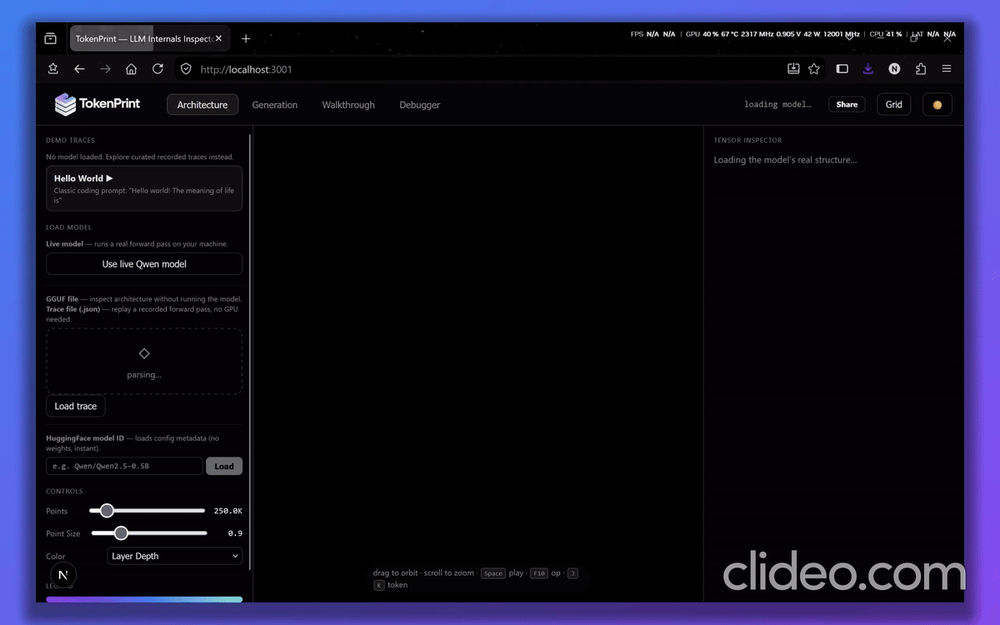

# LLM Visualizer

<p align="center">
  <strong>TokenPrint An interactive platform for exploring LLM internals, model layers, tensors, and token-level computation.</strong>
</p>

<p align="center">
  
  
  
  
</p>

---

## 🎥 Interactive Demo

<p align="center">
  
</p>

<p align="center">
  <sub>Architecture, tensor, layer, projection, walkthrough, attention, and debugger views.</sub>
</p>

---

## 🧭 Overview

LLM Visualizer is built around one idea:

> **Language models become easier to understand when their internal structure can be inspected instead of treated as a black box.**

The application provides an interactive workspace for moving from the high-level architecture of a model down into individual layers, tensors, projections, and internal computations.

Its goal is not simply to display a transformer diagram. It is to connect:

```text
LLM theory
   ↓
model structure
   ↓
layers and components
   ↓
tensors and projections
   ↓
internal computation
   ↓
visual understanding
```

---

## 🔍 What it explores

| Area | Purpose |
|---|---|
| **Architecture** | Inspect the model as a sequence of transformer layers |
| **Layer Visualization** | Move through blocks and inspect their position in the network |
| **Tensor Grid** | Browse tensor groups, shapes, names, and metadata |
| **Projection Views** | Visualize selected transformations spatially |
| **Normalization / MLP** | Inspect intermediate operations with mathematical context |
| **Attention Internals** | Explore attention-related tensors and projections |
| **Walkthrough** | Follow a more guided model-exploration flow |
| **Debugger** | Inspect captured internal state and tensor information |

---

## 🧠 Why this project exists

Most LLM tooling focuses on **using models** or **measuring their outputs**.

LLM Visualizer asks a different question:

> **What is actually happening inside the model?**

The project is intended to make model internals something that can be actively explored, compared, and reasoned about rather than memorized from static diagrams.

---

## 🧩 Interface Areas

### Architecture

Explore the loaded model layer-by-layer and understand how individual components fit into the larger transformer.

### Tensor Grid

Move from:

```text
model → layer → component → tensor
```

without manually digging through raw model metadata.

### Mathematical Context

Selected operations can be paired with their mathematical representation so the UI stays connected to the computation underneath.

### Walkthrough

A guided view for connecting conceptual transformer architecture with the model's actual internal components.

### Debugger

A workspace for inspecting captured tensor information and internal model state during exploration.

---

## 🚧 Project Direction

LLM Visualizer is being developed toward a broader LLM engineering and learning environment, including:

- GGUF model loading and inspection
- tensor-level exploration
- layer and component visualization
- token-level computation views
- attention inspection
- interactive walkthroughs
- debugger-style internal inspection
- integration with an understanding-first LLM Engineering Notebook

---

## 📓 Related Project

### [LLM Engineering Notebook](https://github.com/TheNityant/LLM_Notebook)

The notebook focuses on structured understanding of LLM architecture and engineering, while LLM Visualizer provides the interactive visual layer.

```text
Theory
  ↓
Engineering notes
  ↓
Model inspection
  ↓
Interactive visualization
  ↓
Experiments
```

---

## 📌 Status

The project is under active development. The current build demonstrates the core visual exploration workflow while additional model-inspection and debugging capabilities are being developed.

---

<div align="center">

**Understand what's happening underneath. Then build with it.**

</div>
